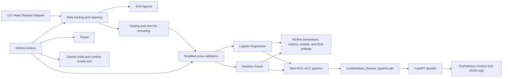

# Heart Disease Risk Prediction with MLOps

This project is a complete machine learning operations solution for predicting heart disease risk using patient clinical records. The goal is to move from raw healthcare data to a production-ready model API that can be trained, tracked, evaluated, containerized, and deployed in a repeatable way.

## Project Overview

The project uses the Cleveland Heart Disease dataset from the UCI Machine Learning Repository. Each record contains demographic, clinical, and diagnostic attributes collected from patients and a target variable indicating whether heart disease is present.

The repository implements an end-to-end ML pipeline with the following stages:
- Data acquisition and validation
- Feature engineering and preprocessing
- Model training with cross-validation
- Experiment tracking with MLflow
- Model artifact storage
- API-based inference service
- Monitoring via Prometheus metrics and structured logs
- Containerization and Kubernetes deployment structure
- CI/CD automation using GitHub Actions

## Problem Statement

Cardiovascular disease remains one of the leading causes of mortality worldwide. Early risk identification can support better clinical decision-making and improve prevention strategies. This project demonstrates how a healthcare risk model can be operationalized using MLOps practices, rather than being treated as a one-off notebook experiment.

The model predicts a binary label:
- 0 = Healthy
- 1 = Risk Detected

## Business Use Case

This project is designed for clinical screening support and decision assistance. It can be used to assess whether a patient is likely to have heart disease based on inputs such as:
- age
- sex
- chest pain type
- resting blood pressure
- cholesterol
- fasting blood sugar
- resting ECG results
- maximum heart rate achieved
- exercise-induced angina
- ST depression
- slope of peak exercise ST segment
- number of major vessels colored by fluoroscopy
- thalassemia result

The application exposes a REST API that receives patient information and returns:
- predicted class
- predicted probability (risk score)
- status label
- response latency in milliseconds

## Core ML Workflow

The project follows a practical MLOps workflow:

1. Load the dataset from a remote source and store it locally in `data/raw/`
2. Validate the schema and labels
3. Split the data into training and test sets
4. Build preprocessing pipelines for numerical and categorical variables
5. Train multiple classification models
6. Evaluate with stratified cross-validation
7. Log metrics and parameters to MLflow
8. Select the best model using ROC-AUC
9. Save the final pipeline as a serialized artifact
10. Serve the trained model via FastAPI for inference
11. Monitor traffic, inference latency, and prediction counts using Prometheus

## Model Details

The project currently evaluates two candidate classifiers:
- Logistic Regression
- Random Forest Classifier

The training script creates a `Pipeline` that includes:
- preprocessing steps for numerical and categorical columns
- the selected estimator

The training pipeline tunes model parameters with 5-fold stratified cross-validation
on the training partition, selects the candidate with the strongest mean ROC-AUC,
and evaluates it on a held-out test partition. It logs the following for each
candidate:
- accuracy
- precision
- recall
- ROC-AUC

Metrics are recorded for both cross-validation and held-out evaluation. The
selected production pipeline is saved in `models/heart_disease_pipeline.pkl`.

## Data Description

The dataset contains 14 columns, including the target variable:

```text
age, sex, cp, trestbps, chol, fbs, restecg, thalach, exang, oldpeak, slope, ca, thal, target
```

The project config file in `config/config.yaml` defines:
- raw dataset URL
- local data paths
- processing paths
- test split ratio
- random seed
- feature group definitions

## Repository Architecture

The codebase is organized into a clean ML project structure:

- `src/data_loader.py` - dataset loading, configuration loading, and preprocessing setup
- `src/eda.py` - reusable EDA visualization generation for standalone and training runs
- `src/features.py` - feature preprocessing logic
- `src/train.py` - model training, MLflow logging, and saving the production pipeline
- `src/app.py` - FastAPI inference service and Prometheus metrics integration
- `notebooks/01_exploratory_data_analysis.py` - exploratory visualization of class balance and feature distributions
- `tests/test_pipeline.py` - validation tests for dataset, preprocessing, and API behavior
- `config/config.yaml` - centralized project configuration
- `k8s/` - Kubernetes manifests for deployment
- `.github/workflows/ci-cd.yml` - CI/CD automation

### Architecture



## Tech Stack

- Python 3.11
- FastAPI
- scikit-learn
- pandas / NumPy
- MLflow
- Prometheus
- Docker
- Kubernetes
- pytest
- GitHub Actions

## Repository Structure

```text
mlops-heart-disease/
├── .github/
│   └── workflows/
│       └── ci-cd.yml
├── config/
│   └── config.yaml
├── data/
│   ├── raw/
│   │   └── heart.csv
│   └── processed/
│       ├── train.csv
│       └── test.csv
├── k8s/
│   ├── deployment.yaml
│   ├── ingress.yaml
│   └── service.yaml
├── models/
│   └── heart_disease_pipeline.pkl
├── notebooks/
│   └── 01_exploratory_data_analysis.py
├── reports/
│   ├── Assignment_01_MLOps_Report_Word_Fixed.docx
│   ├── architecture.png
│   ├── project_overview.mp4
│   └── figures/
├── src/
│   ├── app.py
│   ├── data_loader.py
│   ├── eda.py
│   ├── features.py
│   ├── train.py
│   └── __init__.py
├── tests/
│   ├── conftest.py
│   └── test_pipeline.py
├── Dockerfile
├── requirements.txt
├── ruff.toml
├── mlflow.db
├── mlruns/
├── .dockerignore
├── .gitignore
└── README.md
```

## Data Pipeline

The project loads the dataset from the UCI source and stores it in the local `data/raw` directory. The pipeline then:

1. Reads the raw heart disease dataset
2. Defines numerical and categorical feature groups
3. Applies preprocessing to transform features correctly
4. Splits the data into training and test sets
5. Trains candidate models using cross-validation
6. Logs metrics to MLflow
7. Saves the best-performing model artifact

## Model Training

The training workflow is implemented in `src/train.py`.

It performs the following:
- Loads config from `config/config.yaml`
- Downloads the dataset
- Builds a preprocessing pipeline
- Trains Logistic Regression and Random Forest classifiers
- Runs 5-fold stratified cross-validation
- Evaluates accuracy, precision, recall, and ROC-AUC
- Tracks results with MLflow
- Saves the best model to `models/heart_disease_pipeline.pkl`

To train the model:

```bash
python -m src.train
```

The training run generates EDA figures, stratifies the configured held-out test
split, and tunes each candidate model using 5-fold cross-validation on the training
partition. Logistic Regression searches `C` values of `0.01`, `0.1`, `1`, and `10`;
Random Forest searches tree counts of `100` and `200`, depths of `None`, `3`, and
`5`, and minimum split sizes of `2` and `4`. The best candidate for each model
family is selected by cross-validation ROC-AUC, then evaluated on the held-out
test set. MLflow records the selected parameters, CV and test metrics, serialized
model, the full grid-search results table, and EDA plots for each run. The final
production pipeline is selected by cross-validation ROC-AUC and saved to
`models/heart_disease_pipeline.pkl`.

To run the standalone data preparation and EDA scripts:

```bash
python -m src.data_loader
```

On Windows PowerShell:

```powershell
$env:PYTHONPATH = "."
python notebooks\01_exploratory_data_analysis.py
```

On Linux/macOS:

```bash
PYTHONPATH=. python notebooks/01_exploratory_data_analysis.py
```

## Inference API

The inference service is implemented in `src/app.py` using FastAPI.

### Endpoints

- `GET /health` — checks whether the model is loaded and the API is healthy
- `POST /predict` — accepts patient features and returns a prediction and risk score
- `GET /metrics` — exposes Prometheus metrics

### Example request

```bash
curl -X POST "http://localhost:8000/predict" \
  -H "Content-Type: application/json" \
  -d '{
    "age": 58,
    "sex": 1,
    "cp": 2,
    "trestbps": 120,
    "chol": 240,
    "fbs": 0,
    "restecg": 1,
    "thalach": 160,
    "exang": 0,
    "oldpeak": 1.2,
    "slope": 1,
    "ca": 0,
    "thal": 3
  }'
```

### Example response

```json
{
  "prediction": 1,
  "risk_score": 0.8124,
  "status": "risk_detected",
  "latency_ms": 18.64
}
```

## Local Setup

### BITS Prayogshala (Conda)

The lab may open a terminal in the shared `(base)` environment, which does not
automatically include this project's dependencies. Create and activate a separate
environment, then install the repository requirements before starting the API.
Python 3.11 matches the version used by the CI workflow:

```bash
conda create -n heart-disease python=3.11 pip -y
conda activate heart-disease
cd ~/workspace/MLOps-Assignement/2025ae05860-mlops-heart-disease-assignment
python -m pip install --upgrade pip
python -m pip install -r requirements.txt
python -m pip check
python -m src.train
python -m uvicorn src.app:app --host 0.0.0.0 --port 8000
```

Keep the terminal running Uvicorn open. Use the lab's browser or port-forwarding
feature to open `http://localhost:8000/docs`. Always start Uvicorn with
`python -m uvicorn` from the activated environment so it uses the same Python
interpreter where the project dependencies were installed.

### 1. Clone the repository

```bash
git clone <repository-url>
cd mlops-heart-disease
```

### 2. Create and activate a virtual environment

```bash
python -m venv .venv
source .venv/bin/activate    # Linux/macOS
.venv\Scripts\activate       # Windows
```

### 3. Install dependencies

```bash
pip install -r requirements.txt
```

### 4. Run the training pipeline

```bash
python -m src.train
```

### 5. Start the API

```bash
uvicorn src.app:app --host 0.0.0.0 --port 8000
```

Then open:
- http://localhost:8000/docs for Swagger UI
- http://localhost:8000/metrics for Prometheus metrics

## Docker

Build the image:

```bash
docker build -t heart-disease-api .
```

Run the container:

```bash
docker run -p 8000:8000 heart-disease-api
```

## Kubernetes

The repository includes deployment manifests under `k8s/`:
- `deployment.yaml`
- `service.yaml`
- `ingress.yaml`

These provide the basic structure for deploying the model API into a Kubernetes cluster.

## Monitoring and Experiment Tracking

The project uses:
- MLflow for model and metric tracking
- Prometheus counters and histograms for API telemetry
- Structured JSON logs for inference events

MLflow artifacts are stored locally in the `mlruns/` directory.

## Testing

Run the test suite with:

```bash
pytest
```

The tests validate:
- dataset integrity
- missing-value imputation and target binarization
- preprocessing correctness
- EDA figure generation
- API health endpoint
- prediction endpoint success
- invalid input rejection

## CI/CD

The GitHub Actions workflow in `.github/workflows/ci-cd.yml` runs dependency
installation and validation, strict Ruff linting, data preparation, EDA, training,
and pytest. It then builds the Docker image, starts it as a container, checks
`/health`, sends a sample request to `/predict`, and uploads MLflow and model
artifacts for the workflow run. It also creates a temporary Kind Kubernetes
cluster, applies the deployment manifests, waits for rollout, and checks the
service's health and prediction endpoints. Deployment evidence is uploaded with
the workflow artifacts. Any failed command or endpoint check fails the job.

The same image smoke test can be run locally after building the image:

```bash
docker build -t heart-disease-api .
docker run --rm -p 8000:8000 heart-disease-api
```

In another terminal, verify model readiness and submit a sample request using the
example above. The CI workflow performs both checks automatically and cleans up
the test container.

## Deployment Status

Kubernetes manifests are provided under `k8s/`, including a two-replica
Deployment, a LoadBalancer Service, and an Ingress. They are deployment
configuration; CI deploys them to an ephemeral Kind cluster and verifies rollout,
service health, and prediction behavior. This demonstrates repeatable Kubernetes
deployment in CI, not a persistent cloud deployment. To demonstrate a persistent
deployment for a submission, apply the manifests to a configured Kubernetes
cluster, verify the resulting service and `/health` and `/predict` endpoints, and
save genuine deployment screenshots in `screenshots/`.

## Assignment Deliverables

- Detailed report: `reports/Assignment_01_MLOps_Report_Word_Fixed.docx`
- Architecture illustration: `reports/architecture.png`
- Project overview: `reports/project_overview.mp4` (slide-based)
- Pipeline screen recording: `reports/2025ae05860-mlops-heart-disease-assignment-compressed.mp4`
- CI verifies deployment in an ephemeral Kubernetes cluster. A persistent deployment
  and its screenshots are still required if a lasting cloud/cluster deployment is
  expected for submission.

## Notes

- The project uses a local MLflow tracking server (`mlruns/`) for simplicity in development environments.
- The model artifact is saved under `models/heart_disease_pipeline.pkl` and loaded by the FastAPI app at startup.
- The EDA notebook in `notebooks/01_exploratory_data_analysis.py` can be used to inspect class balance and feature distributions.

## License

This project is intended for educational and demonstration purposes in an MLOps assignment context.
